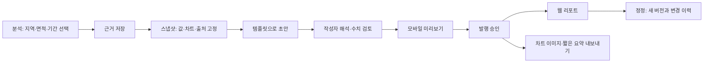
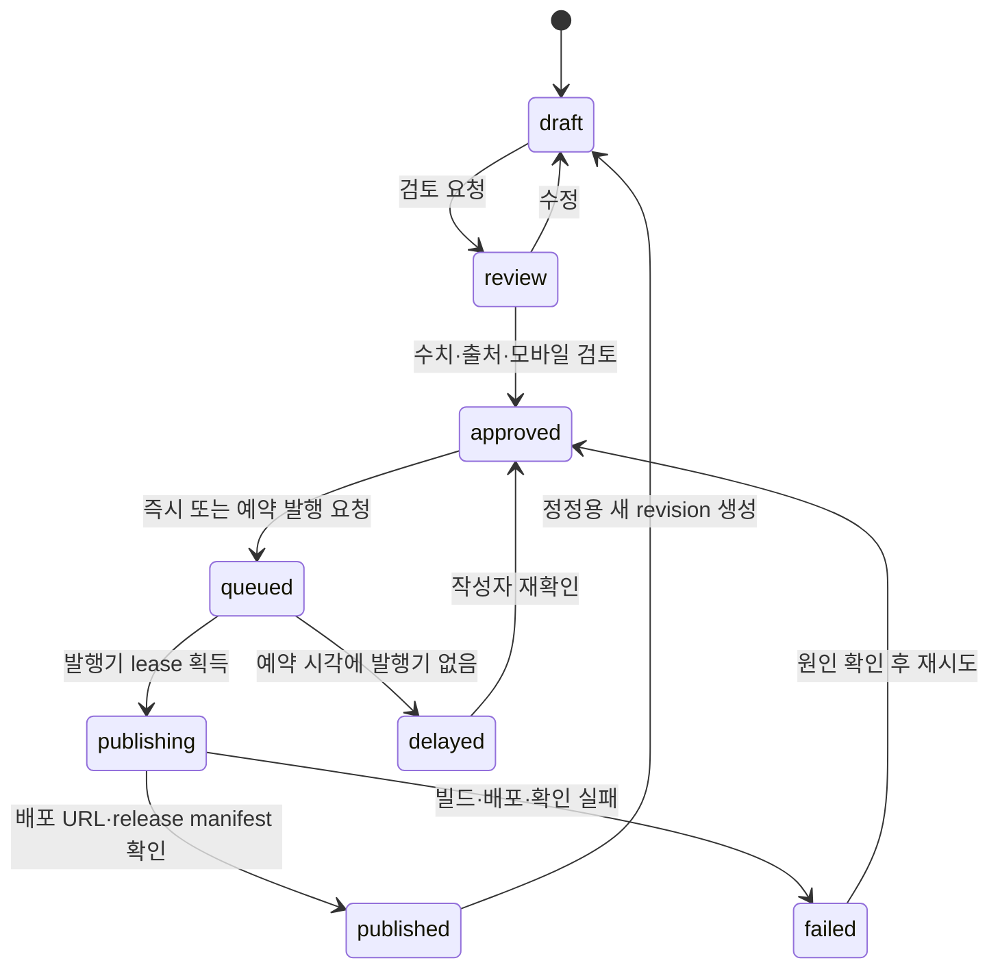

# 부동산 인사이트 — 매수·전월세 데이터와 콘텐츠 발행 설계

2026-11-07 · 설계 제안, 구현·배포 없음. [시장 조사 및 출처](../../research/2026-11-07-real-estate-product-research.md), [기존 디자인 리뷰](../../reviews/2026-11-07-product-design-review.md)를 함께 본다.

## 1. 제품 방향과 범위

사용자가 확정한 대상: **매수자 중심, 일반 독자도 포함, 전세·월세 포함.** 현재 서비스의 데이터 조회를 ‘어디를 어떤 비용으로 검토할지 이해하는 콘텐츠’로 연결한다. 매매 시장만 성장/하락으로 요약하지 않고 임차인의 보증금·월 부담·계약 조건도 독립 질문으로 다룬다.

추천 포지션: **공식 데이터에서 근거를 확인하고, 같은 근거로 읽기 쉬운 글과 차트를 만드는 부동산 콘텐츠 서비스.** 매물 중개·등기 확인·가격예측 서비스까지 확장하는 것은 초기 범위에서 제외한다. 신규 데이터는 아래 콘텐츠를 만들 수 있을 때만 추가한다.

설계자의 기본 선택(사용자가 별도로 확정한 요구는 아님): 처음에는 운영자 1명이 작성·검토·발행한다. 서울·경기부터 시작하며 지역 확대는 데이터 커버리지 검증 후 진행한다. 공개 읽기는 로그인 없이, 작성 공간은 비공개다. 유료화·다중 작성자·자동 SNS 발행은 다음 단계로 남긴다.

### 독자별 첫 질문

| 독자 | 핵심 질문 | 첫 콘텐츠/도구 |
|---|---|---|
| 매수자 | 같은 예산으로 어느 지역·단지를 비교할까? 지금 거래는 충분한가? | 지역 비교 글, 2–3개 단지 비교, 가격 분포·표본·자금 시나리오 |
| 전세 수요자 | 보증금과 주변 전세 거래가 어느 수준인가? 무엇을 추가 확인해야 하나? | 전세 거래 비교, 표본/기간 표시, 확인 항목과 공식 링크 |
| 월세 수요자 | 보증금이 다른 집의 월 부담을 어떻게 비교할까? | 보증금·월세 원값 + 사용자 가정에 따른 환산비용 |
| 일반 독자 | 이번 주 무엇이 바뀌었고 나와 무슨 관련이 있나? | 핵심 변화 3개 + 차트 1–2개 + 관련 지역/임대 콘텐츠 |

성공 기준: 숫자를 찾는 데서 그치지 않고 출처·기간·비교 대상을 이해한 채 다음 탐색으로 이동한다. 운영자는 같은 자료를 다시 복사하지 않고 웹 글·차트 이미지·짧은 요약을 만든다. 구매 시점이나 수익을 단정하는 점수를 핵심 가치로 삼지 않는다.

## 2. 세 가지 접근 비교

| 접근 | 장점 | 비용/한계 | 선택 |
|---|---|---|---|
| 지도·매물 포털 확대 | 탐색 범위가 넓음 | 매물 라이선스·주소/단지 정합·지도 비용, 기존 강자와 정면 경쟁 | 초기 제외 |
| 데이터 분석만 강화 | 기존 구조 재사용 용이 | 독자가 숫자를 해석해야 하고 콘텐츠 발행 공백 유지 | 기반으로 유지 |
| 분석 + 근거 자산 + 콘텐츠 제작 | 기존 _insights/차트/초안 도구를 활용하고 발행 목적과 맞음 | 발행 시점 고정·콘텐츠 상태·출력 품질을 설계해야 함 | **권장** |

RPR의 지역 데이터→기사/소셜카드, Datawrapper의 차트 공유, Ghost의 발행 상태가 참고 패턴이다. 시장에서 이런 기능이 없다는 주장은 하지 않는다. 한국 공식 자료·매수/임차 질문·근거 연결을 차별화 가설로 검증한다.

## 3. 첫 번째 완성 단위

**새 API를 붙이기 전에 현재 데이터로 ‘한 편의 정확한 글’을 만드는 흐름을 완성한다.** 첫 릴리스 범위는 (1) 분석 근거 저장, (2) 고정 스냅샷, (3) 템플릿 3개, (4) 웹 리포트 발행과 이미지/문장 내보내기다.

템플릿:

| 템플릿 | 필수 블록 | 연결 데이터 | 해석 원칙 |
|---|---|---|---|
| 주간 시장 브리핑 | 핵심 변화 최대3, 공식 가격/심리 차트, 최근 완결 월 거래, 전월세 한 항목, 관련 링크 | 기존 R-ONE·실거래·전월세·뉴스 | 서로 다른 기준일을 하나의 ‘이번 주’ 수치로 포장하지 않음 |
| 매수 후보 비교 | 2–3개 지역 또는 단지, 같은 면적대/기간 가격 분포, 거래 건수, 전세 거래, 자금 시나리오 | 기존 거래·임대·예산 함수 | ‘최고의 단지’ 대신 비교 조건과 차이를 제시 |
| 전세·월세 비교 | 전세 보증금 분포, 월세 보증금/임대료 분리, 가정 금리별 비용, 계약 확인 항목 | 기존 전월세 + 사용자 가정, 이후 ECOS | 실제 거래군 비교와 가상의 비용 시나리오를 명시적으로 구분 |

초기 전월세 표본이 없는 지역에서는 전월세 블록을 ‘데이터 없음’으로 두고 전체 지역 결과처럼 발행하지 않는다. 데이터 확보 후 확장하며 임의 샘플로 채우지 않는다.

## 4. 독자 화면과 정보 구조

공개 메뉴는 `브리핑 / 지역·단지 / 전월세 / 리포트`를 주 진입으로 제안한다. 기존 분석 페이지는 `데이터 보기` 아래 묶어 단숨에 삭제하지 않는다. 예산은 지역·단지 비교 및 전월세 콘텐츠에서 연결하고 도구 메뉴도 유지한다. 작성 공간은 공개 메뉴와 분리한다.

- **브리핑**: 현재 지역/범위, 핵심 변화3개, 오늘 읽을 글, 전월세 한 줄, 나머지 분석 링크. 같은 수치를 KPI와 문장 목록으로 두 번 길게 나열하지 않는다.
- **지역·단지**: 검색 → 최대3개 비교 → 가격/거래/임대 탭. 각 차트에 작성자만 보이는 ‘근거로 저장’. 독자에게는 출처·관련 글·조건 링크.
- **전월세**: 전세/월세 탭, 지역·면적·기간, 보증금/월 부담. 금리 가정은 펼침 입력이며 초기값·기준일이 보인다.
- **리포트**: 매수/전세/월세/시장 필터, 제목·요약·발행일. 글 상세는 핵심 결론→근거→독자 확인사항→출처. 더 자세한 정의는 info 버튼.
- **데이터 상태**: 전체 화면에 경고 장문 대신 필요한 값 옆 `잠정`, `표본 부족`, `기준월` 표시. 샘플이면 기존 우상단 목데이터 태그를 유지하되 공개 발행을 차단한다.

### 모바일과 시각 기준

앞선 Slate+Teal 디자인안을 공용 토큰부터 적용한다. 상승 red/하락 blue와 대표색을 분리하고 지역색은 순서가 바뀌어도 고정한다. 본문14–16px, 표13–14px, 축·범례12–13px, 입력16px, 터치44px, 금액 최대 소수2자리 공용 유틸 유지.

390px는 1열, 비교 결과는 지표별 카드/행으로 읽는다. 핵심 값3개를 가로 캐러셀에만 숨기지 않는다. 설명은 탭·키보드로 열리며 기준일/단위/주요 가정은 팝오버에 숨기지 않는다. 필터는 지역·기간만 기본 노출하고 고급 조건은 펼친다. 선택 조건과 초기화는 항상 접근 가능하다.

기존 CLS 개선을 지킨다. 첫 HTML에서 필터·KPI·차트/이미지 종횡비 자리를 예약하고 툴팁·저장 알림은 흐름 밖에 표시한다. 비동기 블록 삽입으로 본문이 밀리지 않게 한다. 제작 편집기는 모바일에서 본문/근거/미리보기를 탭으로 전환하고 드래그 외 위/아래 이동 버튼도 제공한다.

## 5. 콘텐츠 제작 흐름

### 근거 자산

저장 단위는 화면 캡처만이 아니라 ‘어떤 조건으로 얻은 어떤 값/차트인가’다. 지역·단지 ID, 면적 구간, 기간, 취소 제외, 직거래 포함 여부, 계산 버전, 원본 배치/자료 버전, 숫자의 원래 정밀도, 표시 단위, 출처 링크, 표본수, 데이터 기준일을 포함한다. 입력 조건과 실제 집계 범위가 일치해야 한다.

제작자는 저장한 근거를 글에 삽입하고 주석/강조 지점을 지정한다. 지역·기간을 수정하면 기존 근거를 덮어쓰지 않고 새 근거를 만든다. 글에 넣지 않은 근거는 공개하지 않는다.

### 편집기

범용 Notion 복제 대신 블록6종만 제공한다: 제목/요약, 본문, 핵심 숫자, 차트, 비교표, 출처·확인사항. 각 데이터 블록에는 원본 근거로 이동하는 버튼이 있다. 글 본문은 소량의 검증된 Markdown 또는 구조화된 블록으로 저장하고 임의 JS 실행을 허용하지 않는다. 기존 Observable Markdown에 사용자 입력을 그대로 끼워 실행하는 방식은 사용하지 않는다.

MVP는 문서 단위 자동 저장, 저장 완료/실패 상태, 리비전 충돌 알림을 제공한다. 모바일에서 근거 선택·짧은 문장 편집·미리보기·승인이 가능해야 한다. 오프라인 상태에서 미저장 내용을 발행하지 않는다. 다중 작성자 실시간 공동 편집은 제외한다.

### AI는 선택 기능

기본 초안은 기존 _insights와 결정적 템플릿으로 만든다. AI를 사용할 경우 선택한 근거 묶음만 입력으로 주고 제목·요약·평이한 설명·짧은 채널 문구를 제안한다. 모델이 계산한 숫자는 사실 블록에 채택하지 않는다. 수치/기준일/단위는 구조화된 fact 참조로 렌더링하고 수동 해석은 별도 블록에 둔다.

출처 없는 인과·가격 전망을 확정 문장으로 생성하지 않는다. 생성 실패/비용 제한 시 템플릿 편집으로 계속 작업할 수 있어야 한다. MVP에 모델 API나 신규 요금제는 필수가 아니다.

## 6. 발행 모델: 읽기와 쓰기 분리

현재: 로컬 Mac → DuckDB → Observable 정적 빌드 → Pages. 초안은 content/drafts, 발행은 src/reports로 수동 이동. scripts/new_report.py는 사실 문장을 생성하고 본문 해석 자리도 만들지만, 차트는 매번 최신 데이터로 그려져 고정 숫자와 시점이 달라질 수 있다.

### 단계 A — 현 구조에서 먼저 완성

스냅샷 + 템플릿 + 미리보기 + 출력 파일을 기존 로컬 도구에 추가한다. 이 단계의 발행자는 운영자이며 로컬 실행이 필요하다. 웹 독자는 모바일 완전 지원, 휴대폰 원격 작성/예약발행은 이 단계의 제공 기능으로 표시하지 않는다. 현 new_report.py의 인터페이스를 확장하고 새 CMS를 먼저 설치하지 않는다.

- Markdown 본문 + report.json + 집계 데이터/차트 설정 + 이미지 + manifest를 하나의 보고서 패키지로 만든다.
- 미리보기에는 발행 당시 데이터만 사용한다. 대시보드용 최신 Parquet 경로를 보고서 차트에서 참조하지 않는다.
- 같은 스냅샷으로 웹 차트·정적 이미지·짧은 요약을 만든다. 이메일은 이미지+본문/링크로 내보내며 JS 차트 지원을 가정하지 않는다.
- 명시적 발행 실행 후 사이트 빌드·미리보기 검사·배포·운영 확인을 거쳐 완료 처리한다. 추가 데이터 수집을 묵시적으로 실행하지 않는다.
- 공개 데이터 허용 범위 내의 집계 결과만 보고서 패키지에 넣는다. DuckDB 전체·인증키·비공개 초안은 공개 산출물에서 제외한다.

### 단계 B — 모바일 작성·예약이 필요한 웹 제작실

단계 A의 콘텐츠/근거 모델을 그대로 쓰고, 별도 제작실 UI + 작은 Cloudflare Worker API, D1(초안·상태), private R2(근거·출력물)를 추가하는 안을 권장한다. 별도 전체 프레임워크/공개 DB 마이그레이션은 하지 않는다. 근거: Cloudflare의 [웹 앱 Access](https://developers.cloudflare.com/cloudflare-one/access-controls/applications/http-apps/), [D1](https://developers.cloudflare.com/d1/), [R2](https://developers.cloudflare.com/r2/) 문서. 서비스/요금 확정은 구현 전 확인한다.

**근거 생성 위치:** 단계 B의 휴대폰은 Mac에서 집계·검증·업로드한 근거 라이브러리를 선택해 글을 조합한다. 휴대폰에서 지원하지 않는 지역/면적/기간으로 즉석 DuckDB 집계나 새 수집을 요청하는 기능은 제외한다. 새 근거는 운영자가 단계 A 도구로 만들고 업로드한다. 제작실의 조건 선택에는 보유 근거 범위만 표시하고, 미보유 조건은 결과를 추정하지 않는다. 모바일 임의 조건 집계가 필요하면 별도 분석 작업 큐를 다음 범위로 설계한다.

**발행 실행은 기존 로컬 publisher를 유지한다.** 모바일은 어디서든 저장·검토·발행 요청할 수 있으나 Mac이 꺼져 있으면 `발행 대기 · 발행기 연결 안 됨`이다. 요청은 곧 발행이 아니다. 예약 시각에 발행기가 없으면 자동 소급 발행하지 않고 지연 상태로 두어 작성자가 다시 승인한다. 정시 무인 발행이 필요해지면 수집과 분리한 상시 실행 publisher를 도입하는 별도 작업으로 잡는다.

배포 경로는 계획된 `/studio`와 `/api/studio/*`이며 현재 존재하지 않는다. 초기에는 별도 Workers 도메인에 둘 수 있다. custom domain 보유 여부를 확인한 뒤 Access 적용 방식과 Pages의 공개 읽기 경로를 설정한다. 현재 pages.dev 주소의 경로에 Worker를 임의로 붙일 수 있다고 가정하지 않는다. Access UI만으로 보호됐다고 보지 않고 API도 신원·권한을 검증한다. 원본 API 키와 Cloudflare 배포 자격은 브라우저에 전달하지 않는다.

### 상태 전이와 실패

- 승인 이후 본문/근거/출력이 바뀌면 승인을 무효화하고 draft로 돌아간다. queued 상태 수정/승인 철회는 작업 취소와 함께 원자적으로 수행한다. publisher의 lease 획득과 상태 조건을 비교해 이미 publishing이면 취소/수정을 거부한다.
- publishing 중인 report의 편집·승인 철회는 완료/실패까지 잠근다. UI에 발행 중임을 표시하고, 발행 후 정정은 새 revision으로 한다. 배포가 시작된 요청을 취소할 수 있다고 약속하지 않는다. published 원본은 수정하지 않는다.
- idempotency key=`report_id + revision + release_hash`; 중복 클릭/타임아웃 재시도로 같은 글을 두 번 발행하지 않는다.
- publisher는 lease와 heartbeat로 한 작업만 실행한다. 배포 성공 후 상태 기록에 실패하면 공개 release manifest와 배포 ID로 복구한다.
- 기존 공개본은 새 배포의 성공 확인 전까지 유지한다. 실패 시 ‘발행됨’으로 표시하지 않는다.
- 정정은 같은 canonical URL의 새 버전, 정정일·변경점·이전 버전 연결을 제공한다. 최신 분석 대시보드 링크는 별도로 둔다.
- 예약 저장은 UTC, 입력/표시는 Asia/Seoul. 임의 cron 설정은 만들지 않으며 이 문서는 기능 설계다.

## 7. 스냅샷과 데이터 모델 계약

| 객체 | 최소 필드 | 불변/동작 규칙 |
|---|---|---|
| dataset_release | id, source_id, observed_period, published_at, fetched_at, schema_version, hash, license_ref, coverage, status | 가져온 시각과 관측 기간을 분리. 성공 검증 후만 최신 포인터 변경 |
| geography | region_id, code_type, source_code, name, valid_from/to, crosswalk_version | 행정동·법정동·제공기관 지역코드를 혼용하지 않음. 변경 전후 매핑 기록 |
| complex_identity | internal_id, source_id/source_key, 주소키, valid_from/to, match_method/confidence | 단지명 부분일치로 자동 확정 금지. 애매하면 수동 확인/비교 제외 |
| metric_definition | metric_id, formula_version, unit, cycle, denominator, exclusions, min_sample, source_id | 집계법·단위 변경은 새 버전. %와 %p 구분 |
| evidence | id, query_spec, metric_version, dataset_release_ids, period/region/area, raw_value, sample_n, chart_spec, aggregate_asset_hashes | 내용 주소 기반 저장, 보고서가 참조한 근거는 배치로 덮어쓰지 않음 |
| report_revision | report_id, revision, slug, audience/topic, title, summary, blocks, evidence_ids, status, author, timestamps | 승인 버전 고정, 낙관적 동시성 체크. 슬러그/식별자 충돌 거부 |
| publication | report_id/revision, release_hash, scheduled_at, state, deploy_id/url, verified_at, error_code | 요청과 공개 완료 구별, 위 상태 전이 적용 |
| distribution | publication_id, channel, export_hash, external_id, state, sent_at | 웹 발행과 메일 발송 상태 분리. 수동 내보내기는 ‘발송 완료’로 계산하지 않음 |

**스냅샷 혼합의 경계:** 보고서마다 하나의 `release_manifest`를 고정하며 `capture_at`과 데이터 출처별 `dataset_release_id`를 가진다. 모든 출처의 관측일이 같아야 한다는 뜻은 아니다. 주간 가격·전월 거래·월간 금리는 각각 관측 기간을 표시하되, 선택한 릴리스 묶음의 버전만 참조한다. 같은 출처의 서로 다른 릴리스에서 얻은 근거를 섞으면 삽입을 막고 기존 묶음에 맞는 재집계를 요청한다. 재집계가 불가능하면 현재 글에 섞지 않고 별도 버전/글로 유지한다. 새 데이터가 들어와도 manifest를 자동 교체하지 않는다. 동일 hash 자산은 여러 manifest에서 재사용할 수 있다. 단계 B 라이브러리도 release_manifest별로 묶어 호환되지 않는 근거는 선택에서 구분한다.

스냅샷에는 차트가 사용하는 집계 시계열·범주 라벨·숫자 원값·표시 규칙·단위·테마 버전을 포함한다. 공용 차트 렌더러가 나중에 바뀌어도 발행 당시 그림을 볼 수 있도록 SVG/PNG를 함께 보관한다. 인터랙티브 차트는 고정 집계값을 재렌더링하며 정적 이미지가 영구 증거다. 새 배치 후 이전 문장·CSV·이미지 hash가 그대로인지 테스트한다.

원본 전체 DB를 리포트마다 복제하지 않는다. 동일 근거 자산을 hash로 재사용한다. 장기 저장비는 보고서 수×고유 자산 크기로 측정하고, 공개 보고서가 참조하는 자산은 자동 삭제하지 않는다. 공개 취소와 보관 삭제는 별개 명령이다.

## 8. 계산·검증·편집 원칙

### 매수 비교

- 가격 중간값/㎡당 가격은 동일 지역·면적대·기간·취소 조건으로 비교한다. 단지별 거래 구성 변화가 가격 변화처럼 보일 수 있음을 정의에 남긴다.
- 기본 집계 조건/표본 기준은 버전 관리한다. 설계 시작값: 중간값 표본 n<5는 수치 대신 ‘표본 부족’, n=5–19는 주의 표시, 랭킹은 n≥20과 비교 기간 양쪽 충족. 이는 통계적 충분성을 보장하는 법칙이 아니며 실제 분포로 조정한다.
- 0건과 결측, 분모0과 0%를 구분한다. 전기0일 때 증감률 대신 전기/현재 건수를 표시한다.
- 최근 불완전 월은 기본 추세에서 제외하되, 선택하면 잠정 표시와 기준일을 붙인다. 신고 지연 보정 모델을 검증 없이 만들지 않는다.
- 거래회전율은 같은 단지의 기간 내 유효 거래/같은 기준의 세대수. 지역 전체 분모가 없으면 일부 K-apt 세대수로 지역 전체 비율을 만들지 않는다.

### 전월세·비용

- 전세/월세, 신규/갱신 구분은 원본에 해당 필드가 있고 품질 확인이 끝난 범위에서만 노출한다. 없는 구분을 추정하지 않는다.
- 보증금과 월세 원값, 사용자 가정 연 금리 r, 선택 기간을 함께 표시한다. `월 환산비용 = 월세 + 보증금×r/12`이며 매수와 비교할 때는 대출이자·자기자본 기회비용·보유/취득/거래비용·상환 원금을 별도 항목으로 구분한다. 원금 상환을 모두 비용으로 간주하지 않는다.
- MVP는 임대안끼리의 비교와 기존 예산 시나리오 연결까지다. 총 매수 vs 임차 비용 비교는 소유기간·비용·가치 가정이 갖춰진 후 제공한다.
- 전세가율은 기간·면적·매매 n·임대 n을 표시하고 두 집단의 중간값 비율로 명명한다. 특정 주택의 담보/보증 안전 판정에 사용하지 않는다.
- ECOS 평균금리는 제안 가정일 뿐 개인 대출 승인/실제 적용금리가 아니다. 사용자가 바꾸면 ‘사용자 가정’으로 표시한다.

### 발행 전 자동 확인

출처/기준일/단위/표본/사용권 메타 누락, sample 자산, 다른 스냅샷 혼합, 제목/본문의 데이터 참조 불일치, 임시 문구, 깨진 링크, 차트/표 가로 넘침을 검사한다. 구조화된 수치 블록은 원값과 연결해 출력한다. 자유 서술의 모든 숫자 의미를 자동 검증한다고 약속하지 않고, 본문 수동 숫자는 검토 목록으로 보여 작성자가 확인한다.

RSS는 제목·매체·발행일·링크를 재사용한다. 기사 본문·이미지를 복제하는 수집기로 확대하지 않는다. 공공데이터라는 이유만으로 모든 원본·지도·이미지·API에 동일한 재배포 권리를 가정하지 않는다.

## 9. 추가 데이터 도입 순서

| 단계 | 데이터/기능 | 완료 조건 |
|---|---|---|
| 0 | 기존 데이터의 발행 스냅샷·근거·템플릿3개·출력 | 새 배치 뒤에도 발행 글/차트 일치, 공개 초안 없음, 실패 복구 확인 |
| 1a | ECOS 기준/주담대 금리, 부동산원 실거래가격지수 | 실제 통계·항목코드/주기/단위 확인, 샘플 응답·과거 커버리지 테스트, 기존 지수와 구분 |
| 1b | 인허가·착공·준공·미분양 | 공식 표/파일 어댑터 확정, 흐름/재고 구분, 개정 이력·지역 매핑 검증 |
| 1c | K-apt 단지 기본정보 | 단지 매핑 확정 및 대상 범위 표시, 회전율 분모 검증 |
| 2 | 웹 제작실·모바일 작성·발행 대기 | 인증·자동저장·충돌·lease·오프라인 발행기 UX 검증 |
| 3 | 청약·인구/세대·이동 | 공고 변경·분모·행정구역 매핑, 각각 만들 콘텐츠 확보 |
| 4 | ESP 뉴스레터·예약·성과, 서울 정비사업 | 수신동의/구독해지·API 권한·중복 발송 방지. 외부 서비스 계약 검토 |

실데이터 API 수집은 이 설계 작업에서 실행하지 않는다. 새 키는 기존 .env와 서버 secret 관리 방식으로 보관하고 브라우저에 입력시키지 않는다. 기존 MOLIT 키 하나가 모든 기관의 서비스를 승인받았다는 뜻은 아니다.

첫 구현의 권장 순서는 **디자인 공용 토큰·접근성 → 스냅샷/근거 → 템플릿3개 → 발행/이미지 출력 → 금리/공급 데이터**다. 디자인 리뷰 전체와 모든 신규 데이터·CMS를 한 번에 묶지 않는다.

## 10. 검증과 출시 기준

- 단위: 비용 계산 경계(금리0/음수 입력 거부/월세0/보증금0), 단위·%p·표본0·분모0, 지역/단지 키 매핑, 스냅샷 hash 안정성.
- 통합: 초안→검토→고정 패키지→미리보기→공개, 배치로 원본 바뀐 뒤 과거 글 불변, 승인이후 수정 무효화, 배포 실패 뒤 이전 공개본 유지.
- 웹 제작실 도입 시: 익명 API 쓰기 거부, 타인/만료 세션 거부, 입력 sanitize·임의 코드 실행 차단, 중복 요청·네트워크 타임아웃·서로 다른 탭 충돌 검증.
- 모바일: 320/390/1440, light/dark, 200% 확대, 긴 제목/금액, 키보드 표 상세·근거 이동·설명 개폐. 실제 iOS Safari와 VoiceOver 확인.
- 성능: 초기 로딩·필터·칩 삭제 CLS 측정. 기존 측정과 같은 조건으로 회귀 비교하고 공개 읽기에서 개인 작성용 라이브러리/비공개 데이터 다운로드 없음 확인.
- 콘텐츠 파일럿: 주간 브리핑4회 + 매수 비교2편 + 전월세2편. 초안 준비시간·근거 누락·정정 수·독자의 관련 단지/비용 도구 이동을 측정한다. 목표 수치는 파일럿에서 기준선 확보 후 확정한다.

설계상 바로 정할 수 있는 선택은 위에 명시했다. 남은 제품 검증: 주 독자의 예산/지역, 실제로 쓰는 배포 채널, 모바일 작성 빈도. 이 답이 없어도 단계0은 구현 계획을 세울 수 있으나 외부 발송·정시 예약·유료화는 확정하지 않는다.

## 11. 범위와 남은 확인

이 문서는 기능 설계이며 사이트 변경·키 신청·배치 수집·뉴스레터 발송·스케줄 생성·배포를 수행하지 않았다. 공식 문서로 제품 기능과 데이터 존재를 확인했지만 신규 API 인증 호출·사용권 계약·운영 비용·실제 응답 커버리지는 구현 단계에서 검증해야 한다. 유료/로그인 제품 기능은 공개 설명 범위로만 판단했다.

## 12. 설계 검토 반영

독립 구현 검토에서 근거 생성 위치, 발행 중 수정 경쟁, 여러 출처의 스냅샷 경계를 지적했다. 단계 B 모바일은 업로드된 근거 선택으로 한정하고, publishing 편집 잠금과 queued 취소의 원자적 전이를 명시했다. 보고서 단일 release_manifest와 출처별 릴리스 고정으로 관측일 차이와 버전 혼합을 구분했다. 이는 설계자의 선택이며 제품 구현/검증을 완료했다는 뜻은 아니다.

## 13. 그래픽·데이터 표현을 통한 차별화

추가 사용자 요구: 데이터를 예쁘고 효율적으로 보여 주는 차별점. 권장 방향은 **질문을 먼저 보여 주고, 비교와 근거를 단계적으로 펼치는 그래픽**이다. 차트 종류를 많이 제공하는 것보다 매수/임차의 핵심 질문에 맞춘 3종을 제품의 대표 시각화로 만든다. 다음은 설계 제안이며 사용자 검증으로 차별성이 입증된 상태는 아니다.

### 대표 시각화 3종

| 이름/독자 질문 | 그래픽과 상호작용 | 데이터·구현 조건 |
|---|---|---|
| **같은 돈, 다른 선택** — 내 예산이면 어디를 비교할까? | 단지 2–3개를 같은 축 위에 나란히 배치. 최근 거래의 가운데 50% 구간과 중간값, 내 예산 세로선, 거래 건수를 표시. 단지를 누르면 면적·연식·거래 목록이 펼쳐짐 | 기존 실거래로 우선 구현. 최근 6개월/동일 면적대 등 조건 고정. 예산이 분포에 있다는 것은 현재 매물이 있다는 뜻이 아님. 필터 후 n<5는 범위 대신 표본 부족 |
| **보증금과 월 부담** — 보증금을 바꾸면 매달 얼마가 달라질까? | x=보증금, y=월세 산점도. 비교할 실제 거래를 최대3개 고르고, 같은 가정 금리의 월 환산비용을 연결된 가로 막대로 비교. 금리 조정 시 원값은 유지하고 가정 결과만 갱신 | 기존 월세 거래의 같은 지역·면적·기간에서 시작. 전세 거래는 월세0의 별도 구분으로 표시. 서로 다른 계약을 같은 집의 협상 가능한 옵션처럼 연결하지 않음. 동일 주택 보증금 전환 곡선은 사용자가 직접 입력한 시나리오에만 사용 |
| **우리 동네 변화 카드** — 가격·거래·임대가 함께 어떻게 바뀌었나? | 가격/거래/전세/월세를 3–4개의 작은 차트로 정렬. 날짜를 누르면 세로 기준선과 값이 함께 이동. ‘흐름 → 선택 시점 → 근거’로 펼침 | 같은 지표의 지역 패널끼리는 같은 축. 단위가 다른 지표는 별도 축/패널. 주간·월간 자료는 날짜/주기를 개별 표시하고 미발표 값을 채워 넣지 않음 |

첫 구현은 **같은 돈, 다른 선택**을 권장한다. 이미 가진 데이터로 만들 수 있고 매수자 질문에 직접 답하며, 같은 구성을 전세 보증금 비교에도 사용할 수 있다. 이어 월세 비용 비교와 변화 카드를 추가한다.

### 읽는 그래픽에서 만드는 그래픽으로

각 분석의 저장 상태를 `차트 설정 + 데이터 버전 + 제목/주석 + 출처`로 정의해 콘텐츠 자산으로 재사용한다. ‘스토리로 만들기’를 누르면 같은 근거를 다음 3장으로 구성한다.

1. 질문/핵심 수치 한 개 — 단정적 매수 권유 대신 관측값.
2. 비교 차트 — 같은 축, 직접 라벨, 선택 대상 강조.
3. 해석/확인할 항목 — 표본·기준일과 원문 링크.

웹 인터랙티브, 세로형 카드, 가로형 차트에서 **같은 데이터·색·숫자·출처**를 사용하되 각 비율에 맞춰 레이아웃을 다시 배치한다. 긴 웹 차트를 그대로 줄여 캡처하지 않는다. 출력 프리셋은 1080×1350 카드와 1600×900 차트부터 시작하며 이는 채널의 필수 규격이 아니라 제품 내보내기 기본값이다. 출처/기준일은 항상 이미지에 포함한다. 전월세 비용 가정도 이미지에서 빠지지 않는다.

### 그래픽 문법과 효율

- 제목은 ‘㎡당 가격 변화’에 독자 질문을 병기한다. 차트 안에는 필요한 결론/주석1–2개만. 표본·기준일·단위는 상시, 계산 정의는 info로 이동.
- 중립 배경과 Teal 조작색을 유지하고 사용자가 선택한 대상만 강하게 강조한다. 지역 ID별 고정색을 유지하며 다른 선은 투명도만으로 읽기 어려워지지 않도록 직접 라벨/선형을 병용한다.
- 기본 뷰는 가격 추이·분포·비교처럼 익숙한 형태. 레이더 종합점수·의미 없는 게이지·3D 차트·복수 단위의 과도한 이중축을 기본 표현으로 쓰지 않는다.
- 거래 밀도가 높을 때는 서버/빌드 집계한 분포·구간별 건수부터 보여 주고 상세 요청 때 거래점을 연다. 전체 raw 거래를 차트별로 중복 다운로드하지 않는다. 기존 ECharts를 우선 재사용한다.
- 필터 변경은 해당 그래픽과 연결 요약만 갱신한다. 불필요한 페이지 재등장 모션은 없앤다. 선택/강조 모션은 150–250ms 시작값으로 검증하며 reduced-motion을 따른다.
- 모바일에는 hover를 요구하지 않는다. 탭한 값 고정, 선택 해제, 키보드 대체 표를 제공한다. 작은 차트는 세로로 배치하고 비교 축/기준점을 유지한다. 과도한 범례를 줄인다.
- 성능·가독성 검증: 390px에서 10초 안에 예산 대비 위치/선택한 계약 월 부담/비교 기간을 찾는 과제로 사용자 테스트. 성공률·오답·소요시간으로 개선을 판단하고 ‘예쁘다’ 평가는 별도로 수집한다. 차트/출력물 높이 예약으로 CLS 회귀를 확인한다.

참고: [Datawrapper 작은 차트 배열의 비교 원칙](https://www.datawrapper.de/blog/what-to-consider-when-creating-small-multiple-line-charts), [Redfin 구매부담 데이터](https://www.redfin.com/news/data-center/), [RPR의 분석→콘텐츠 전환](https://blog.narrpr.com/support/ai-script-writer-2/). 사례의 기능을 그대로 복제하거나 독점적 발명으로 주장하지 않고 한국 매수·전월세 질문에 맞게 조합한다.
